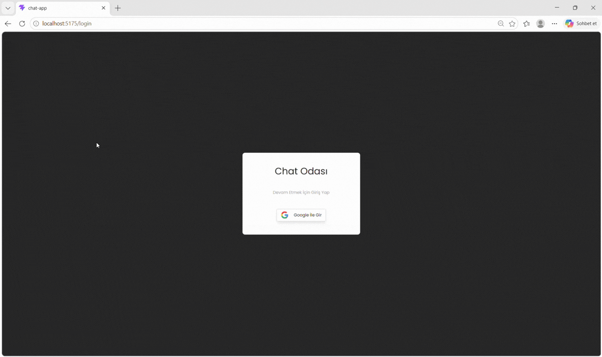

# 💬 Chat-App

Chat-App is a modern real-time messaging application built with React and Firebase. It provides a seamless communication experience through room-based conversations, user authentication, and a responsive interface.

---

## 📌 Project Overview

This project was developed to practice real-time communication, Firebase integration, and modern React application architecture.

### 🚀 Key Features

- 💬 Real-time messaging with Cloud Firestore
- 👤 Secure user authentication with Firebase
- 🏠 Room-based chat system
- 🔄 Instant message updates
- 📱 Responsive and user-friendly interface
- ⚡ Fast and smooth user experience
- 🔔 Interactive notifications with React Toastify
- 🧩 Component-based React architecture

---

## 🛠️ Technologies Used

- **React.js** – Frontend development
- **JavaScript (ES6+)** – Application functionality
- **Firebase Authentication** – User authentication
- **Cloud Firestore** – Real-time database
- **React Router DOM** – Page navigation
- **Tailwind CSS** – Responsive UI design
- **React Toastify** – Toast notifications
- **Vite** – Development and build tool

---

## 🎯 Project Purpose

The main goal of this project is to improve practical skills in React development, Firebase Authentication, real-time database management, and building interactive messaging applications.

It also focuses on creating reusable components, managing user interactions, and delivering a modern, responsive chat experience.

### 💬 Application Preview

